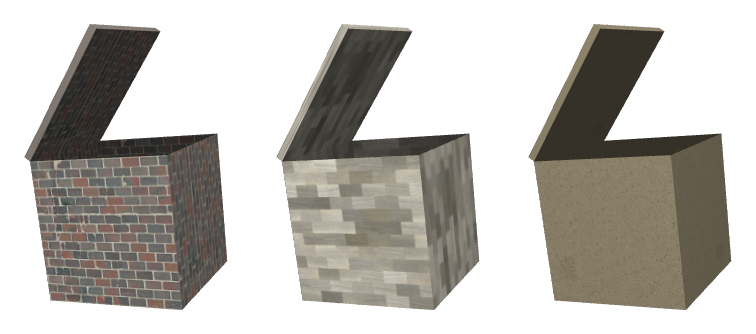

# 📦 Textured Box with Phong Lighting

An interactive WebGL2 scene with an open textured box and a hinged lid. You can rotate the box, push it closer or further away, open the lid, move the point light around and switch between three textures. Lighting is per-fragment Phong (ambient + diffuse + specular), and all the matrix math comes from a small hand-written `m4` module.

**Live demo:** https://pgerasymchuk.github.io/webgl2-textured-box-lighting/



🎓 Made for the Computer Graphics course at Igor Sikorsky Kyiv Polytechnic Institute (3rd year, spring 2025).

## Controls

| Input | Action |
|-------|--------|
| Click on the canvas | Next texture (brick, stone tiles, sand) |
| `↑` / `↓` | Open / close the lid (0° to 180°) |
| `←` / `→` | Rotate the box around the Y axis |
| `8` / `2` | Rotate around the X axis |
| `4` / `6` | Rotate around the Z axis |
| `0` / `1` | Move the box along the Z axis |
| `A` / `D` | Move the light along X |
| `W` / `X` | Move the light along Y |
| `3` / `5` | Move the light along Z |

The current light position is shown under the canvas.

## How it works

### Geometry and buffers

`coords.js` describes two meshes:

- **box**: a 1×1×1 cube without the top face (front, back, bottom, left and right), 20 vertices;
- **lid**: a thin 1×0.05×1 slab sitting on top of the box, 24 vertices.

Each mesh has its own vertex array object with an interleaved position + texture coordinate buffer (stride 20 bytes), a separate normal buffer and an index buffer. Switching between them in the render loop is just `bindVertexArray`.

### Transformations

- The camera sits at `(0, 0, 5)` and looks at the origin (`m4.viewMatrix`), with a 45° perspective projection.
- The box model matrix is a translation along Z followed by rotations around X, Y and Z, all driven by the keyboard.
- The lid is attached to the box hierarchically. Its matrix is `boxModel · T(-0.5, 0.5, 0) · Rz(angle) · T(0.5, -0.5, 0)`, so it turns around the box's top-left edge like a hinge and follows every move of the box.
- The normal matrix is the inverse transpose of the model matrix, so normals stay correct for any rotation.

`m4.js` is a small matrix module: identity, perspective and orthographic projections, translation, rotation and scaling matrices, look-at, multiply, invert and transpose.

### Lighting (Phong)

The vertex shader passes the world-space position, the transformed normal and the texture coordinates on to the fragment shader, which computes:

- **ambient**: `0.8 · ambientColor · texColor`, so the unlit sides still show their texture;
- **diffuse**: `max(dot(N, L), 0) · diffuseColor · texColor`;
- **specular**: `0.5 · max(dot(V, R), 0)^32 · specularColor`, with `R = reflect(-L, N)` and the viewer at the camera position.

The light is a white point light that starts at `(0, 5, 10)` and moves in steps of 1 unit.

### Textures

The three 1024×1024 JPEG textures are loaded before the first frame (`Promise.all` over `Image.onload`). Each one gets mipmaps, `REPEAT` wrapping and trilinear filtering (`LINEAR_MIPMAP_LINEAR`). The active texture is bound to unit 0 every frame, so switching textures is just a change of index.

## Run locally

The shaders are fetched at runtime, so serve the folder over HTTP:

```bash
git clone https://github.com/pgerasymchuk/webgl2-textured-box-lighting.git
cd webgl2-textured-box-lighting
python -m http.server 8000
```

Open http://localhost:8000 and use the keyboard and mouse as described above.

## Project structure

```
index.html                 canvas and controls description
app.js                     buffers, textures, input handling, render loop
coords.js                  box and lid vertices, normals, indices
m4.js                      4x4 matrix helpers
utils.js                   shader compilation and program linking
vertex.vert, fragment.frag Phong lighting shaders
textures/                  brick, stone and sand textures
docs/                      preview image
```

## Tech stack

- WebGL2 (vertex array objects, mipmapped textures), GLSL ES 1.00 shaders
- Vanilla JavaScript ES modules, no dependencies or build step
- Hand-written 4×4 matrix library
- Static hosting on GitHub Pages
